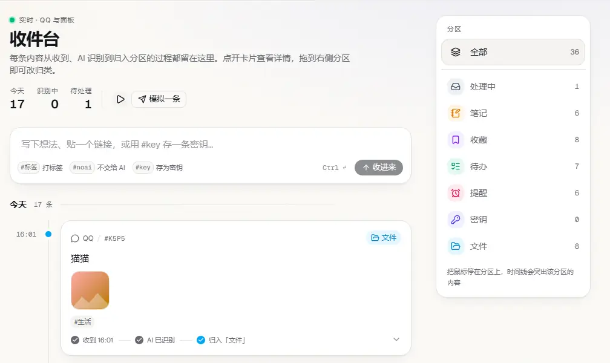
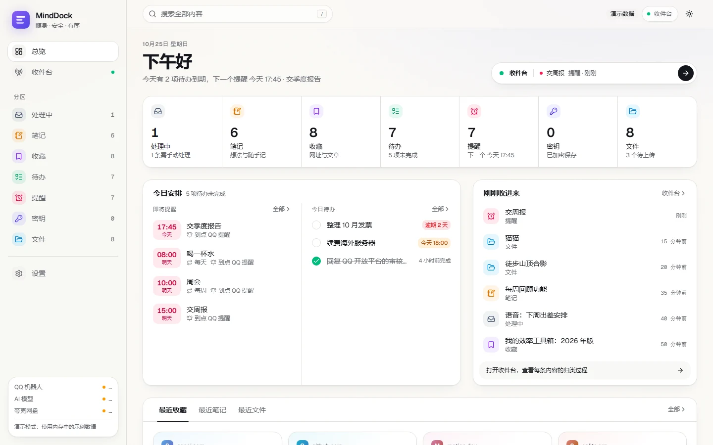
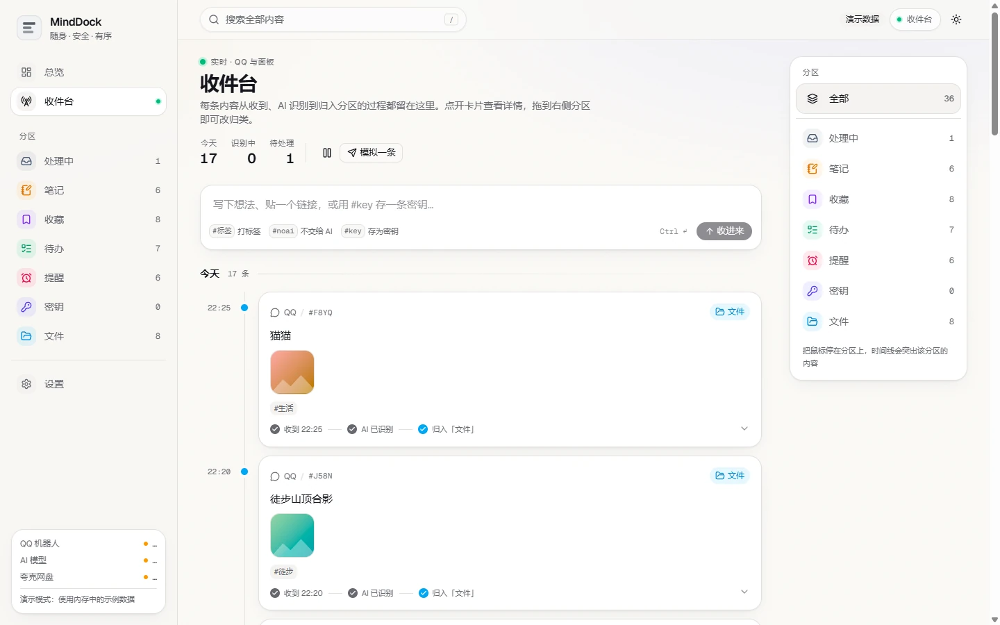
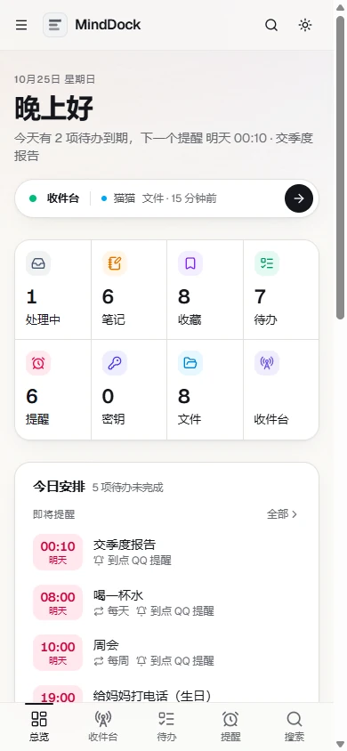
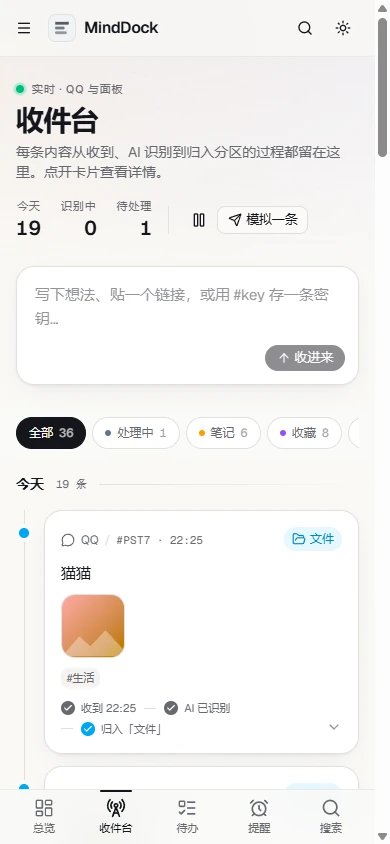
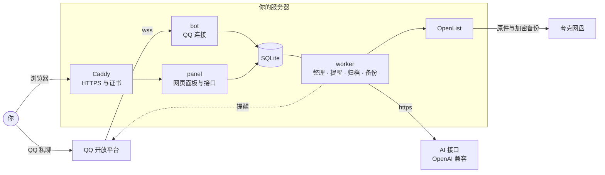

<div align="center">

<picture>
  <source media="(prefers-color-scheme: dark)" srcset="web/public/favicon-dark.svg" />
  
</picture>

# MindDock

**随身、安全、分门别类的第二大脑**

把想法、链接、图片和文件发给 QQ 机器人，随手收下，自动归位。<br />
MindDock 帮你整理、提醒和归档；密码等敏感内容单独加密，在网页面板里随时查找。

[](https://github.com/tianyin231/MindDock/actions/workflows/ci.yml)
[](https://github.com/tianyin231/MindDock/releases)
[](LICENSE)
[](https://github.com/tianyin231/MindDock/pkgs/container/minddock)

[功能](#功能) · [截图](#截图) · [部署](#部署) · [使用](#使用) · [备份与迁移](#备份与迁移) · [安全设计](#安全设计) · [本地开发](#本地开发) · [更新日志](CHANGELOG.md)

</div>

<p align="center">
  <picture>
    <source media="(prefers-color-scheme: dark)" srcset="docs/images/stream-demo-dark.webp" />
    
  </picture>
</p>

## 功能

- **QQ 就是收件箱**：文字、网址、图片、视频、文件直接发给机器人，秒回执；AI 生成标题、摘要和标签，归入笔记、收藏、待办、提醒、文件等分区，没整理好的留在"处理中"。
- **到点提醒**：说"明天下午三点提醒我交周报"就会设好；优先回复在你最近的消息下面，不占主动消息额度，再兜底 QQ 主动消息和邮件；支持每天 / 每周 / 每月重复，QQ 里 `/done`、`/later` 直接处理。
- **密钥库**：`#key` 开头或被自动识别为密码、令牌的消息，在落盘前加密，不交给 AI；只有输入二级密码后才在浏览器里解开，服务器上只有密文。
- **原件归档到夸克网盘**：经内置 OpenList 上传并核对大小，图片生成缩略图，本地只暂存 7 天，之后按需从夸克取回；Cookie 失效立即告警。
- **收件台**：所有内容按时间排成一条时间线，每张卡片记着"收到 → AI 识别 → 归入分区"的轨迹；点开看摘要和附件，拖到分区栏就能改归类，也可以直接在网页里投递。
- **网页面板**：分区总览、全文搜索、详情抽屉、手机布局；浅色 / 深色主题与配套图标，支持手动选择或跟随系统；登录要密码加新设备验证码。
- **省心运维**：一条命令部署（自动装 Docker），每天加密备份到本地和夸克，一条命令迁移到新服务器。

## 截图

<picture>
  <source media="(prefers-color-scheme: dark)" srcset="docs/images/overview-dark.webp" />
  
</picture>

<picture>
  <source media="(prefers-color-scheme: dark)" srcset="docs/images/stream-dark.webp" />
  
</picture>

<p align="center">
  
  &nbsp;&nbsp;
  
</p>

<sub>截图使用演示数据。GitHub 会按你的浅色 / 深色主题显示对应的截图。</sub>

## 工作方式



全部跑在 Docker Compose 里：bot、panel、worker 三个进程共用一个镜像和一个 SQLite 数据库。完整设计见 [docs/design.md](docs/design.md)。

## 部署

需要一台能装 Docker 的 Linux 服务器（root，内存 1 GB 以上即可，实际占用约 200 MB）和一个已解析到它的域名。

```bash
curl -fsSL https://raw.githubusercontent.com/tianyin231/MindDock/main/deploy/install.sh | bash -s -- minddock.example.com
```

脚本会：缺 Docker 时自动安装 → 生成 `/opt/minddock/.env`（加密主密钥等，只在服务器上）→ 选择入口模式 → 拉取镜像并启动 → 生成备份密钥 → 打印面板地址和一次性初始化码。

然后打开 `https://<域名>`：

1. 用初始化码创建账号，用验证器 App 扫码绑定；
2. 在「设置」里填 **QQ 机器人**（[QQ 开放平台](https://q.qq.com) 的 AppID 与 AppSecret）、**AI 模型**（任意 OpenAI 兼容接口）、**夸克网盘**（Cookie），每项都能一键测试，邮件通知可选；
3. 在 QQ 里把面板上显示的绑定码发给机器人，它从此只认你。

| 入口模式 | 何时使用 | 做法 |
| --- | --- | --- |
| 独立模式 `direct` | 干净的服务器，80 / 443 空闲 | Caddy 直接监听 80 / 443，自动申请和续期证书 |
| 宝塔模式 `bt` | 装有宝塔，443 还要分给其他服务 | 宝塔 nginx 把 80 转给 Caddy，把 443 上本域名的连接按 SNI 转给 Caddy（不解密） |

默认自动选择（有宝塔用宝塔模式，否则独立模式），也可以用 `--mode direct` 或 `--mode bt` 指定，结果记在 `.env` 的 `MINDDOCK_MODE`。

<details>
<summary>宝塔模式的细节</summary>

443 由 nginx 的四层配置 `/www/server/panel/vhost/nginx/tcp/sni_443.conf` 按域名分流，只转发、不解密，证书由 Caddy 自动申请和续期（Let's Encrypt）。因此宝塔里的网站不能再直接开启 443 的 SSL，否则会与分流冲突；需要时在该文件的 map 中为域名加一条转发。

容器在宝塔"Docker → 容器编排"里显示为 `minddock`；域名可以在"网站 → Docker"里添加为反向代理网站（目标容器 `minddock-caddy-1`，端口 8081），代替 install.sh 写入的 nginx 配置。

</details>

**更新**：`bash /opt/minddock/deploy/update.sh`。镜像由 GitHub Actions 构建并发布到 `ghcr.io/tianyin231/minddock`：`main` 跟随最新提交，`0.2.0` 这样的版本标签对应正式版本，`sha-xxxxxxx` 便于回滚；在 `.env` 里改 `MINDDOCK_TAG` 即可固定版本。

**忘记密码或丢失验证器**：删除登录账号后重新初始化，笔记和设置都不受影响。

```bash
cd /opt/minddock
docker compose exec panel python -m minddock reset-account
docker compose restart panel && sleep 5 && docker compose logs panel | grep 初始化码
```

## 使用

直接把东西发给机器人就行。几个约定：

| 写法 | 作用 |
| --- | --- |
| `明天下午三点提醒我交周报` | 设为提醒，回执里回显解析出的时间 |
| `#标签` | 打标签，可以写多个 |
| `#noai` | 不交给 AI，留在"处理中"手动归类 |
| `#key 名称`，换行写内容 | 加密存入密钥库，可附图片或文件；发完建议撤回原消息 |

| 命令 | 作用 |
| --- | --- |
| `/s 关键词` | 搜索 |
| `/todo` | 未完成的待办 |
| `/提醒` | 接下来的提醒 |
| `/done #编号` | 完成待办或提醒（不写编号指刚收到的提醒） |
| `/later 30m` | 刚收到的提醒稍后再提醒（也可写 `2h`、`1d`，或 `/later #编号 2h`） |
| `/help` | 查看用法 |

## 备份与迁移

每天 03:15 自动备份一次，失败时 QQ 告警；配置了夸克就同时上传到夸克归档目录下的 `backups/`（保留最近 30 份，另加最近 12 个月每月一份）。面板「设置 → 备份」可以查看状态、立即备份、下载备份文件。

备份包含数据库快照、密钥类文件的密文、还没上传夸克的原件、缩略图和部署配置，用 [age](https://age-encryption.org) 公钥加密。服务器上只有公钥；安装时生成的私钥写在 `/root/minddock-backup-key.txt`，**存进密码管理器后删除这个文件**，没有它无法解密备份。不依赖 MindDock 也能解开：`age -d -i 私钥文件 备份文件 | tar -xz`。

```bash
# 立即备份（保存在 /opt/minddock/data/panel/backups/，本地保留最近 7 份）
bash /opt/minddock/deploy/backup.sh

# 恢复演练：只解密并校验全部内容，不改动现有数据
cd /opt/minddock && docker compose exec -T panel python -m minddock restore --check \
  /data/backups/minddock-20261025-031500.tar.gz.age < 私钥文件
```

**迁移到新服务器**：

1. 旧服务器上运行 `backup.sh`，把生成的备份文件复制到新服务器；
2. 域名的 A 记录改到新服务器；
3. 新服务器上运行（会提示粘贴备份私钥，也可以用 `--key 私钥文件`）：
   ```bash
   curl -fsSL https://raw.githubusercontent.com/tianyin231/MindDock/main/deploy/install.sh | bash -s -- minddock.example.com --restore /root/minddock-20261025-031500.tar.gz.age
   ```
4. 停掉旧服务器上的 MindDock（`docker compose down`），否则两边会同时收 QQ 消息；QQ 开放平台若设了 IP 白名单，改成新 IP。

恢复时先在临时目录解密，逐个核对 SHA-256、数据库完整性和版本，全部通过才写入；已上传夸克的原件不用搬，用到时自动从夸克取回。

## 安全设计

| 对象 | 保护方式 |
| --- | --- |
| 面板登录 | 密码 + 新设备 TOTP 验证码，受信任设备 30 天免验证码，登录限速与审计日志 |
| 设置里的密钥（AppSecret、API Key、Cookie） | 用 `.env` 中的主密钥加密存储，接口只返回末尾 4 位 |
| 密钥库 | libsodium sealed box；私钥由二级密码（Argon2id）包裹，只在浏览器里解开；另有一次性恢复码 |
| 传输 | 面板 HTTPS；QQ 网关 wss，附件下载、AI 与夸克接口一律 https，遇到明文地址直接拒绝 |
| 备份 | age 公钥加密，解密私钥只在你手里 |

需要知道的边界：

- **QQ 消息不是端到端加密**，发给机器人的内容腾讯服务器能看到；普通消息还会交给你配置的 AI 服务商整理（识别为密钥的不会）。
- 真正重要的凭据（银行、主邮箱、服务器）请在面板「密钥」页用「新增」录入：内容在浏览器里加密后才发出，腾讯和 AI 服务商都接触不到。

## 本地开发

需要 [uv](https://docs.astral.sh/uv/) 和 Node.js 22 及以上版本。

```bash
# 后端（本地是 http，需关闭 Cookie 的 Secure 标记）
cd server
uv run pytest
MINDDOCK_COOKIE_SECURE=false uv run python -m minddock panel   # http://127.0.0.1:8080

# 前端
cd web
npm install
npm run dev      # http://127.0.0.1:5173，接口请求转发到 8080
```

首次打开会进入初始化页，初始化码打印在后端日志里。收消息和 AI 整理需要另外启动 `python -m minddock bot` 和 `python -m minddock worker`。

只调界面、不想启动后端时，可以用演示数据：`VITE_DEMO=1 npm run dev`，在收件台点"模拟一条"就能看到完整的归类动画。

```text
server/   Python 后端（uv 项目，FastAPI + SQLite）
web/      React 前端（Vite + Tailwind CSS + shadcn/ui + Motion）
deploy/   安装、更新、备份脚本与 Caddy 配置
docs/     设计文档
```

## 路线图

- [x] QQ 收件闭环、AI 归类、到点提醒、密钥库、夸克归档
- [x] 收件台、一键部署、加密备份与迁移
- [ ] 备份另存一份到 Cloudflare R2
- [ ] PWA：添加到手机桌面
- [ ] 语义搜索与"相关内容"，QQ 里用 `/q` 提问并引用条目
- [ ] 每日 / 每周回顾摘要
- [ ] 音视频转写

## 协议

[MIT](LICENSE)
